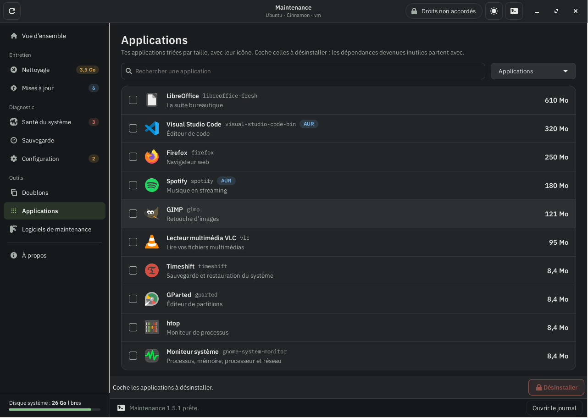

# Maintenance

Nettoyage, mises à jour et santé d’Arch Linux, dans une seule fenêtre GTK3 pensée pour Cinnamon.
Rien ne repasse par le terminal : les commandes lancées et leur résultat s’affichent dans le
journal d’activité en bas de la fenêtre.


## Ce que fait l’application

| Section | Contenu |
|---|---|
| Vue d’ensemble | Espace disque, place à récupérer, mises à jour, santé, dernier instantané, liste « À faire » |
| Nettoyage | Restes de téléchargement pacman, cache des paquets (`paccache`), orphelins, journaux systemd, cache AUR, caches des applications, miniatures, corbeille, Flatpak, Docker |
| Mises à jour | Système et AUR (`pacman -Syu` puis `yay -Sua`), Flatpak, firmware (`fwupd`), miroirs (`reflector`), trousseau de clés |
| Santé du système | Disques (SMART), TRIM du SSD, services en échec, erreurs du journal, espace par dossier |
| Sauvegarde | Instantanés Timeshift, export de la liste des paquets |
| Configuration | Fichiers `.pacnew` / `.pacsave` à fusionner (avec Meld), intégrité des paquets, noyaux installés |
| Doublons | Recherche par taille puis empreinte SHA-256, mise à la corbeille, une copie toujours gardée |
| Applications | Applications installées avec leur icône, triées par taille, désinstallation (`pacman -Rns`) |
| Logiciels de maintenance | Timeshift, BleachBit, GParted, GSmartControl, Czkawka, Meld… à installer ou ouvrir |
| À propos | Version installée, liens du projet, mise à jour de l’application, informations sur le système |



## Installation

```bash
git clone https://github.com/TheWorms/maintenance.git
cd maintenance
./installer.sh
```

`installer.sh` installe `base-devel` et `git`, retire une éventuelle ancienne copie dans
`~/.local/bin`, puis construit et installe le paquet `maintenance-git` avec `makepkg -si`.
On peut aussi le faire à la main : `makepkg -si` dans le dossier du dépôt.

L’application apparaît dans le menu Cinnamon (Administration › Maintenance) et se lance aussi
avec la commande `maintenance` ou `nettoyage`.

## Mises à jour

Chaque commit poussé sur ce dépôt devient une nouvelle version du paquet (`rNOMBRE.COMMIT`).
Dans l’application, la page **À propos** affiche la version installée et la compare au dernier
commit de GitHub (avec son numéro de version et la liste des nouveautés). Quand une version plus
récente est publiée, un badge apparaît sur « À propos » et le bouton **Mettre à jour** clone le
dépôt, reconstruit le paquet avec `makepkg` et l’installe avec `pacman -U`. L’application propose
ensuite de redémarrer. **Vérifier à nouveau** relance la comparaison sans redémarrer l’application.

Sans l’application : relancer `./installer.sh` fait la même chose.

Le dépôt doit être public pour que l’application le voie sans identifiants. S’il est privé,
lance une fois `gh auth setup-git` pour que `git` utilise ton compte GitHub (la liste des
nouveautés restera alors vide).

## Sécurité

- **Mode simulation** activé au premier lancement : les actions qui modifient le système sont
  seulement affichées dans le journal. Les analyses (SMART, journaux, vérifications) sont réelles.
- **Mot de passe demandé une seule fois**, à l’ouverture de l’application, dans une fenêtre
  de l’application (le curseur est déjà dans le champ). `sudo` lance alors un petit assistant
  administrateur qui exécute toutes les commandes administrateur jusqu’à la fermeture : ça marche
  même si sudo ne garde pas le mot de passe en mémoire (`timestamp_timeout=0`). Seule l’application
  qui l’a lancé peut lui parler (tubes privés) ; il s’arrête dès qu’elle se ferme. Le cadenas de la
  barre de titre permet de retirer ou de redonner les droits.
- **Logiciels administrateur sans second mot de passe** : GSmartControl, GParted et Timeshift
  s’ouvrent avec la session ; Flatpak et les firmwares (fwupd) passent aussi par elle.
- **yay sans second mot de passe** : ses appels `sudo pacman` passent par l’application (relais
  local réservé aux programmes qu’elle a lancés ; seule la commande `pacman` est acceptée).
- **Fichiers .pacnew** : Meld s’ouvre avec ton compte sur des copies de travail ; le fichier
  d’origine n’est réécrit que si tu l’as modifié.
- **Paquets protégés** : le noyau, pacman, yay, sudo, systemd, le bureau Cinnamon et l’application
  elle-même ne peuvent pas être désinstallés depuis la liste des applications.
- **Bouton Arrêter** (barre de titre, ligne en cours, ou touche Échap) : coupe une analyse ou un outil
  qui prend du temps (SMART, vérification des paquets, espace par dossier, doublons…) et ne lance
  pas les étapes suivantes. pacman, yay, la mise à jour du firmware et la création d’un instantané
  ne sont jamais coupés au milieu : l’arrêt attend la fin de leur étape.
- **Fermeture bloquée** pendant une opération, pour ne jamais interrompre pacman.

## Désinstallation

```bash
sudo pacman -Rns maintenance-git
```

Les réglages sont dans `~/.config/maintenance/reglages.json`.

## Développement

```bash
python3 maintenance.py      # lance la version du dépôt sans l’installer
```

Une seule dépendance Python : PyGObject (`python-gobject`), avec GTK 3.

## Licence

MIT, voir [LICENSE](LICENSE).
