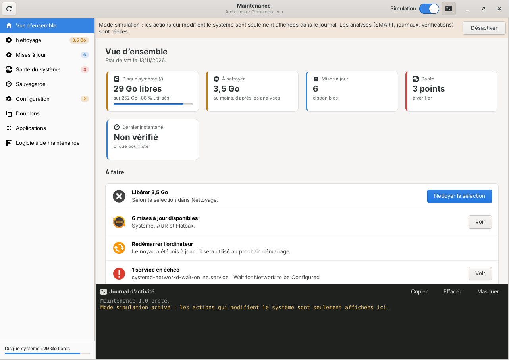

# Maintenance

Nettoyage, mises à jour et santé d’Arch Linux, dans une seule fenêtre GTK3 pensée pour Cinnamon.
Rien ne repasse par le terminal : les commandes lancées et leur résultat s’affichent dans le
journal d’activité en bas de la fenêtre.



## Ce que fait l’application

| Section | Contenu |
|---|---|
| Vue d’ensemble | Espace disque, place à récupérer, mises à jour, santé, dernier instantané, liste « À faire » |
| Nettoyage | Restes de téléchargement pacman, cache des paquets (`paccache`), orphelins, journaux systemd, cache AUR, caches des applications, miniatures, corbeille, Flatpak, Docker |
| Mises à jour | Système et AUR (`pacman -Syu` puis `yay -Sua`), Flatpak, firmware (`fwupd`), miroirs (`reflector`), trousseau de clés, l’application elle-même |
| Santé du système | Disques (SMART), TRIM du SSD, services en échec, erreurs du journal, espace par dossier |
| Sauvegarde | Instantanés Timeshift, export de la liste des paquets |
| Configuration | Fichiers `.pacnew` / `.pacsave` à fusionner (avec Meld), intégrité des paquets, noyaux installés |
| Doublons | Recherche par taille puis empreinte SHA-256, mise à la corbeille, une copie toujours gardée |
| Applications | Applications installées avec leur icône, triées par taille, désinstallation (`pacman -Rns`) |
| Logiciels de maintenance | Timeshift, BleachBit, GParted, GSmartControl, Czkawka, Meld… à installer ou ouvrir |


## Installation

```bash
git clone https://github.com/TheWorms/maintenance.git
cd maintenance
./installer.sh
```

`installer.sh` installe `base-devel` et `git`, retire une éventuelle ancienne copie dans
`~/.local/bin`, puis construit et installe le paquet `maintenance-git` avec `makepkg -si`.
On peut aussi le faire à la main : `makepkg -si` dans le dossier du dépôt.

L’application apparaît dans le menu Cinnamon (Administration › Maintenance) et se lance aussi
avec la commande `maintenance` ou `nettoyage`.

## Mises à jour

Chaque commit poussé sur ce dépôt devient une nouvelle version du paquet (`rNOMBRE.COMMIT`).
Dans l’application, la ligne **Mises à jour › Maintenance (cette application)** compare la
version installée au dernier commit de GitHub, liste les nouveautés et propose
**Mettre à jour** : le dépôt est cloné, le paquet reconstruit avec `makepkg`, puis installé avec
`pacman -U`. L’application propose ensuite de redémarrer.

Sans l’application : relancer `./installer.sh` fait la même chose.

Le dépôt doit être public pour que l’application le voie sans identifiants. S’il est privé,
lance une fois `gh auth setup-git` pour que `git` utilise ton compte GitHub (la liste des
nouveautés restera alors vide).

## Sécurité

- **Mode simulation** activé au premier lancement : les actions qui modifient le système sont
  seulement affichées dans le journal. Les analyses (SMART, journaux, vérifications) sont réelles.
- **Mot de passe demandé une seule fois**, à l’ouverture de l’application, dans une fenêtre
  (`SUDO_ASKPASS`). L’autorisation est entretenue tant que l’application reste ouverte, puis rendue
  à la fermeture (`sudo -k`). Le cadenas de la barre de titre permet de la retirer ou de la redonner.
- **yay sans second mot de passe** : ses appels `sudo pacman` passent par l’application (relais
  local réservé aux programmes qu’elle a lancés ; seule la commande `pacman` est acceptée).
- **Paquets protégés** : le noyau, pacman, yay, sudo, systemd, le bureau Cinnamon et l’application
  elle-même ne peuvent pas être désinstallés depuis la liste des applications.
- **Fermeture bloquée** pendant une opération, pour ne jamais interrompre pacman.

## Désinstallation

```bash
sudo pacman -Rns maintenance-git
```

Les réglages sont dans `~/.config/maintenance/reglages.json`.

## Développement

```bash
python3 maintenance.py      # lance la version du dépôt sans l’installer
```

Une seule dépendance Python : PyGObject (`python-gobject`), avec GTK 3.

## Licence

MIT, voir [LICENSE](LICENSE).
